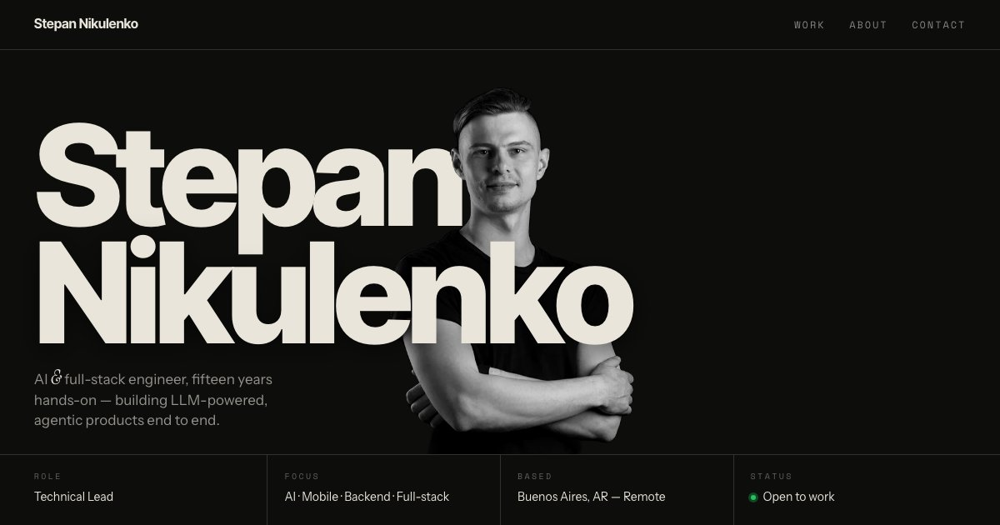

<a href="https://steppannws.github.io/portfolio/">
  
</a>

# Stepan Nikulenko

**AI & full-stack engineer, fifteen years hands-on — building LLM-powered, agentic products end to end.**

Technical Lead · AI · Mobile · Backend · Full-stack · Buenos Aires, AR — Remote · 🟢 Open to work

**[View the site ↗](https://steppannws.github.io/portfolio/)** · **[Portfolio deck ↗](https://steppannws.github.io/portfolio/deck.html)** · **[CV (PDF) ↗](https://steppannws.github.io/portfolio/uploads/Stepan-Nikulenko-CV.pdf)**

## AI & agentic development

I design, build and run AI agents in real delivery — not demos.

- **Agent design & implementation** — LLM-powered agents with tool use, planning and memory, wired into real systems through MCP servers.
- **Agentic workflows** — multi-step automations that take on actual engineering work: coding, reviews, QA and internal operations.
- **LLM integration** — model selection, prompt and context engineering, cloud APIs and local LLMs for private internal tools.
- **AI-native delivery** — day-to-day development with Claude Code and Cursor, with custom skills, hooks and MCP servers that extend them.

## What else I do

|                          |                                                                                                       |
| ------------------------ | ----------------------------------------------------------------------------------------------------- |
| **Mobile development**   | React Native at scale, native Swift and Kotlin bridges, release pipelines and performance work.       |
| **Backend development**  | Node.js services, PostgreSQL, microservices and the integrations that hold products together.         |
| **Technical leadership** | Teams of up to twelve engineers — code standards, mentoring, turning requirements into shipped scope. |

## Selected work

|             | Project                                         |                                                                                                                                        |
| ----------- | ----------------------------------------------- | -------------------------------------------------------------------------------------------------------------------------------------- |
| 2021 — 2026 | **Goalsetter** · FinTech                        | Banking and investing for the next generation. Engineer → technical lead on the flagship app. 100K+ downloads.                         |
| 2025 — 2026 | **Goalsetter Classroom** · EdTech               | Web apps and microservices bringing financial literacy into schools — built with agentic development and AI best practices.            |
| Startup     | **[Tydee](https://www.tydee.io/)** · Co-founder | Multi-tenant platform for cleaning companies — web, admin and mobile, built end to end with agentic development and AI best practices. |
| 2021        | **Ace Hardware Rewards** · Retail               | Rewards app on the starter I architected — performance profiling, analytics, engineering oversight.                                    |

Plus six earlier products and games (2010 — 2021): Club Premier, Aeromexico, Humber, Guía Arqui, Disney, Dakar.

## Contact

[stepan.nikulenko@gmail.com](mailto:stepan.nikulenko@gmail.com) ·
[LinkedIn](https://www.linkedin.com/in/stepann/) ·
[GitHub](https://github.com/steppannws) ·
[Stack Overflow](https://stackoverflow.com/users/6078160/stepan-nikulenko) ·
[Behance](https://www.behance.net/stepan)

---

## About this repo

An interactive landing page and a 16-slide presentation deck. Vite + React +
TypeScript, plain CSS Modules over design tokens, tested with Vitest and
Playwright, deployed to GitHub Pages via Actions.

### Pages

| Entry                      | What it is                                                                                         |
| -------------------------- | -------------------------------------------------------------------------------------------------- |
| `index.html` → `/`         | Landing — editorial one-pager: paper/band alternating sections, oversized display type, dark-only  |
| `deck.html` → `/deck.html` | 16-slide deck — keyboard nav (arrows/Home/End), hash-linkable slides, scale-to-fit 1920×1080 stage |

### Development

```bash
npm install
npm run dev        # dev server
npm test           # unit tests (Vitest)
npm run test:e2e   # smoke tests (Playwright; needs `npx playwright install chromium` once)
npm run lint       # ESLint
npm run build      # production build → dist/
```

### Architecture notes

- **Two static entries, no router** — the landing and the deck are separate
  Vite HTML entries; there's no SPA navigation between them.
- **Two surfaces, not a colour palette** (`src/styles/tokens.css`) — the landing
  alternates between two paper stocks: `paper` (default) and `band`
  (`data-surface="band"` on a section). Components only ever read the neutral
  tokens `--bg`, `--ink`, `--muted`, `--faint`, `--hair`, so a section inverts
  by switching stock. `data-theme` on `<html>` swaps which stock is dark, so the
  alternating rhythm survives in both themes. The deck is dark-only and uses its
  own literal palette.
- **Shared editorial primitives** live in `src/styles/global.css` as global
  classes — `.shell` (12-column measure), `.grid12`, `.eyebrow` (numbered
  section rule), `.display`, `.serif` (the one italic counterpoint, used twice
  on the page), `.chip`. Section CSS Modules compose on top.
- **Logic lives in hooks** (`src/hooks/`) — `useTheme` (persistence +
  OS-preference default; currently unused — the landing is pinned dark in
  `index.html`), `useReveal` (in-view fade) and `useDeckController`
  (slide index, keyboard nav, hash sync, scale-to-fit). Components stay
  presentational.
- **Work is two-tier** — 4 flagships via `FlagshipProject` (text column on the
  grid + a visual that bleeds off the page edge for imagery, `bleed={false}` for
  text-based visuals) and 6 archive rows via `WorkIndex`, driven by
  `src/data/compactProjects.ts`. **10 deck project slides** — all data-driven via
  one `ProjectSlide`, plus a Tydee mobile gallery slide.
- **No canvas, no custom cursor** — the landing is type, rules and imagery; the
  only motion is the skill marquee and a 10px in-view fade, both disabled under
  `prefers-reduced-motion`.
- **Easter egg** (`src/lib/climber/`) — tap the face in the hero portrait and a
  pixel mountaineer drops onto the surname; arrows (or an on-screen pad on
  touch) walk, jump and drop it across the page's text and images. `engine.ts`
  is pure physics + floor detection (unit-tested), `render.ts` draws the sprite
  with Three.js on a transparent WebGL overlay, loaded on first use.

## Author

**Stepan Nikulenko** — Technical Lead · Mobile & Full-Stack Engineer
Buenos Aires, Argentina · Remote

- Email: stepan.nikulenko@gmail.com
- LinkedIn: [in/stepann](https://www.linkedin.com/in/stepann/)
- GitHub: [@steppannws](https://github.com/steppannws)
- Stack Overflow: [stepan-nikulenko](https://stackoverflow.com/users/6078160/stepan-nikulenko)
- Behance: [stepan](https://www.behance.net/stepan)
